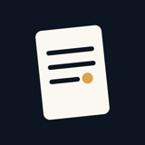
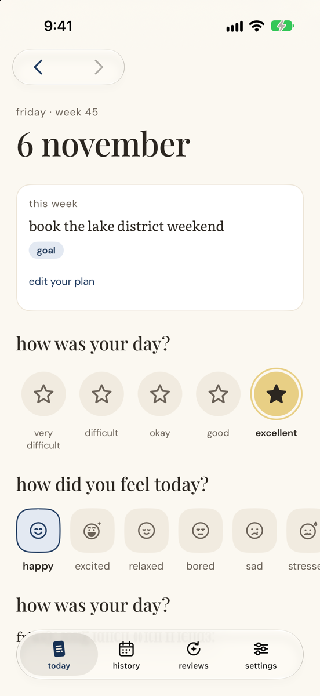
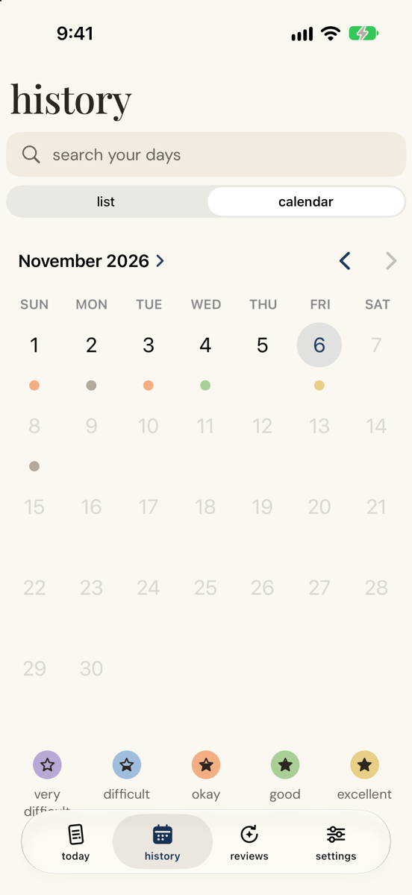
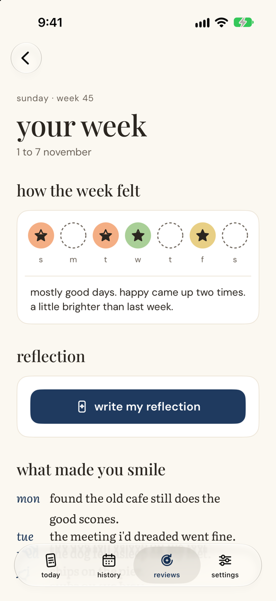
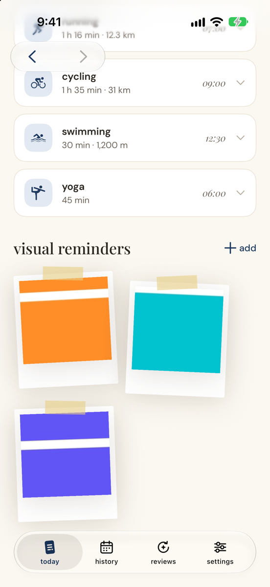
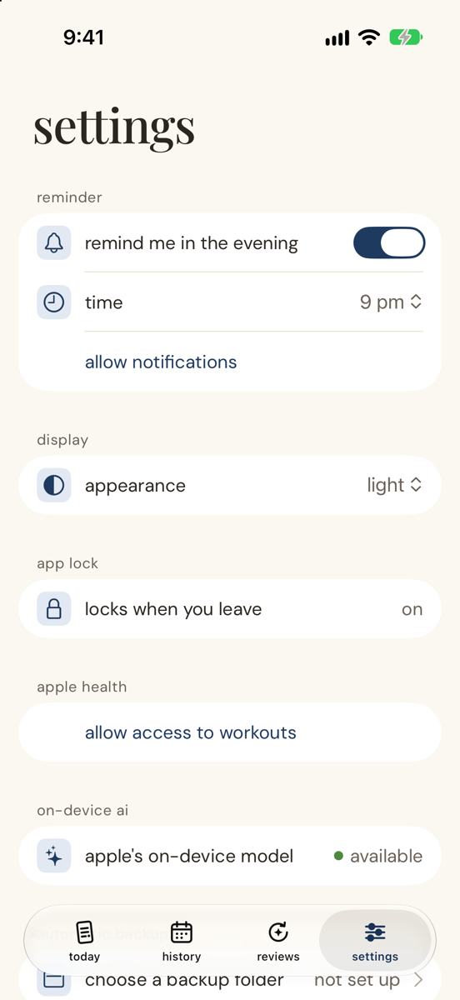
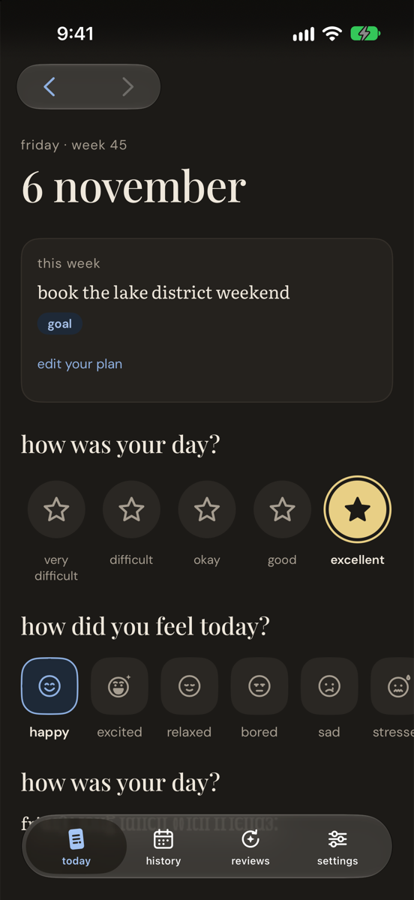

<p align="center">
  
</p>

<h1 align="center">be reyt</h1>

<p align="center"><em>a little space for your day.</em></p>

<p align="center">
  A private, single-user journal for iPhone. Score the day, name how you felt, write a few lines and note what made you smile.
  Everything stays on your phone: no account, no server, no network calls.
</p>

<p align="center">
  
  &nbsp;
  
  &nbsp;
  
</p>

---

## What it does

**Today.** One page per day, ready to fill in:
- **how was your day?** A five-step score, from very difficult to excellent.
- **how did you feel today?** Pick any number of feelings from a carousel (happy, excited, relaxed, bored, sad, stressed and more).
- **Entry.** Free text, plus "what made you smile today?" and a rotating reflection question you can swap for another.
- **Weekly plan.** On Sunday, set one thing you want or need to do next week (a goal, a need to do, a want to do, or something you're looking forward to). It stays on every day of that week, and the next Sunday asks how it went.
- **Activities.** Workouts from Apple Health (runs, rides, swims, yoga and more) appear on their day. Duplicates from different apps are merged into one card, and the route map loads live when you expand a card.
- **Visual reminders.** Attach photos to the day.

**History.** A calendar with a coloured dot for each day's score, a list view, and search across everything you've written.

**Reviews.** Every Sunday you get a look back at the week: the scores, your most common feelings, what made you smile and how the plan went. A short written reflection is generated **on the phone** with Apple's on-device model.

**Settings.** An evening reminder that only fires if the day is still empty, light and dark appearance, Face ID lock, Apple Health access, backups and exports.

<p align="center">
  
  &nbsp;
  
  &nbsp;
  
</p>

## Privacy by design

- **Nothing leaves the phone** except backups you choose to make. The app has no networking, web views or analytics, and `scripts/privacy-check.sh` fails if any of them show up in the source or the built binary.
- **On-device AI only.** Reflections use `SystemLanguageModel.default`. Private Cloud Compute is on the same banned list.
- **Locked when you leave.** Face ID guards the app, and the app switcher shows a cover instead of your words.
- **Encrypted backups.** Manual and automatic backups are Apple Encrypted Archives protected by your passphrase. Photos are encrypted separately with a random key held inside the snapshot. They can be opened on a Mac without the app ([how](#opening-a-backup-on-a-mac-disaster-recovery)).
- **Health data is read, never written.** Workout routes are read live and never stored.
- **Journal text is never logged.**

## Bring your journal in, take it out

- **Import from Apple Journal.** Preview the export first, then confirm. Re-importing skips duplicates.
- **Readable exports.** Export to PDF or Markdown to read or share.
- **Delete all data.** Asks you to confirm it's you and type a confirmation. Your backup files are left untouched.

## How it's built

| | |
|---|---|
| **App** (`App/`) | SwiftUI app target: screens, platform glue (HealthKit, notifications, Face ID, backups, exports) |
| **ReytKit** (`Packages/ReytKit`) | Swift package: models, domain logic, the SwiftData store and the archive format. No SwiftUI or UIKit. |

- Swift 6 with strict concurrency. iOS 27, SwiftData with a versioned schema and a migration plan from day one.
- `JournalStore` is the only writer of journal records. Views read with `@Query`.
- One definition of "this day has an entry" drives reminders, coverage and history dots.
- All user-facing copy lives in `App/Copy.swift`, all lowercase.
- Dynamic Type, light and dark mode, and accessibility labels on every control.

The project rules are in [`CLAUDE.md`](CLAUDE.md).

---

## Development

### Requirements

- Xcode 27.0, iOS 27.0 SDK, Swift 6
- `brew install xcodegen`
- Signing: Apple Developer Program team `C76RQ9NG73` (automatic), Apple ID signed in to Xcode

### Build

```sh
xcodegen generate
swift test --package-path Packages/ReytKit
xcodebuild -project BeReyt.xcodeproj -scheme BeReyt \
  -destination 'platform=iOS Simulator,name=be reyt,OS=27.0' build
```

Create the simulator once: `xcrun simctl create "be reyt" "iPhone 17 Pro Max" com.apple.CoreSimulator.SimRuntime.iOS-27-0`

### Checks

```sh
swift format lint --strict --recursive App Packages
scripts/privacy-check.sh
```

### Install on the phone

```sh
scripts/install-device.sh
```

The phone must be unlocked, trusted, and in Developer Mode. Add `--release` for a Release build (see [Daily use build](#daily-use-build)).

### Daily use build

`scripts/install-device.sh` builds a Debug build by default. For daily use, install a Release build (faster, and without the Debug-only launch arguments):

```sh
scripts/install-device.sh --release
```

The development profile lasts a year; run it again to re-sign before it expires. Same bundle id and team, so your data stays.

### TestFlight

```sh
scripts/testflight.sh            # archive + export only, to check signing
scripts/testflight.sh --upload   # archive + upload to App Store Connect
```

The build number is a UTC timestamp, so every upload is higher than the last. Bump `MARKETING_VERSION` in `project.yml` for a new version. Needs the app record for `local.mitchel.bereyt` in App Store Connect. TestFlight builds expire after 90 days. Installing from TestFlight replaces a dev install in place (same bundle id and team keeps your data). Do not delete the app: that deletes local data.

### Debug launch arguments

Debug builds only; Release builds ignore all of these.

- `-skipLock` bypasses the app lock (the simulator has no Face ID enrolled by default).
- `-pretendToday YYYY-MM-DD` sets today's date.
- Demo data: `-seedHistory` (about twenty days across Oct and Nov 2026, best with `-pretendToday 2026-11-06`), `-seedDemoDay`, `-seedWorkouts`, `-seedPhotos`, `-seedSundayPlan`.
- `-appearance light|dark|system` sets the appearance.
- `-designGallery` shows the design gallery; `-showOnboarding` / `-skipOnboarding` force or skip onboarding, `-onboardingStep <n>` jumps to a step.
- `-openHistory calendar|list`, `-openReview YYYY-MM-DD`, `-openSettings`, `-openReviews`, `-openReadableExport`, `-openDeleteAll`, `-openRestoreBrowser`, `-openPassphrase`, `-openPhotoViewer` open that screen directly.
- `-reflectionState <state>` sets the review reflection state; `-forceSaveFailure` fails the next save.
- `-forceWaiting` / `-forceOpenFailed` / `-showPrivacyCover` show the lock screen's other states.
- `-showRestoreNote` / `-showDeleteAllNote` show the result banners.

The README screenshots were taken with:

```sh
-skipLock -skipOnboarding -pretendToday 2026-11-06 -seedHistory -seedWorkouts -seedPhotos
```

plus `-openHistory calendar`, `-openReview 2026-11-01`, `-openSettings`, `-scrollToPhotos` or `-appearance dark` for each screen.

### Device checklist

Tick these on the phone; none of them can be proven in the simulator.

#### Install and launch
- [ ] `scripts/install-device.sh` installs and launches; the app opens and shows today.
- [ ] Signing expiry: the settings "about" row shows the days left; the banner appears near expiry.

#### Face ID lock
- [ ] Lock on, background the app, return: Face ID is asked; cancel leaves the lock screen.
- [ ] App switcher shows the cover, never journal text (also with a photo or a sheet open).

#### HealthKit workouts
- [ ] Allow access: workouts appear on the day page; deny: the copy explains iOS never reveals a denial.

#### Reminders
- [ ] 9 pm delivery on an empty day, and the delivered reminder is removed once the day has content.

#### Backup and restore
- [ ] Automatic backups: pick an iCloud folder; "uploaded" and "waiting" states; airplane mode; evicted-snapshot listing; folder deleted; the "on my iphone" warning for a local folder.
- [ ] Passphrase change re-uploads the photos under the new key; `pending changes` clears after a run.
- [ ] Restore: an evicted snapshot, an older passphrase, undo, restore browser labels, the post-restore "use this backup's passphrase" question.
- [ ] Generated reflections: airplane-mode generation, AI-off copy, edits purge a stale narrative.
- [ ] Exports: share sheet, and Files opens the PDF and the zip.
- [ ] Apple Journal import of your real export: preview, confirm, history, re-import shows duplicates.
- [ ] Delete all data (only with a backup first): re-auth and typed confirm, journal empty afterwards, backup files untouched, passphrase cleared.

---

## Opening a backup on a Mac (disaster recovery)

Backups (`.aea`) are Apple Encrypted Archives using the scrypt password profile. To open one without the app:

```sh
aea decrypt -i be-reyt-export-YYYY-MM-DD-xxxxxxxx.aea -o backup.aar -password-value 'PASSWORD'
aa extract -i backup.aar -d backup/
```

`PASSWORD` is your backup passphrase, **plus the suffix ` | be reyt backup` if your passphrase is shorter than 20 bytes** (Apple's engine rejects shorter passwords, so the app appends this fixed suffix). Example: passphrase `sunny dog` → password `sunny dog | be reyt backup`. The extracted folder holds `manifest.json`, `data.json` and `attachments/`.

## Recovering an automatic backup on a Mac

The automatic backup folder (`be reyt backups/`) holds `snapshots/`, `pre-restore/` and `blobs/`.

**1. The snapshot (your entries and settings).** A snapshot is the same kind of file as a manual export, so use the same command and the same passphrase rule as above:

```sh
aea decrypt -i be-reyt-YYYY-MM-DD-xxxxxxxx.aea -o snapshot.aar -password-value 'PASSWORD'
aa extract -i snapshot.aar -d snapshot/
```

The extracted folder holds `manifest.json`, `data.json` and `dataKey.bin`. It has no photos: they are separate files.

**2. The photos.** Each photo is one encrypted file at `blobs/<first 2 characters>/<name>.aea`. They are encrypted with a random 256-bit key (not your passphrase). That key is `dataKey.bin` inside the snapshot, and it is a raw 32-byte file, so it can be passed straight to `aea`:

```sh
aea decrypt -i blobs/ab/abcdef....aea -o photo.heic -key snapshot/dataKey.bin
# or, with the key inline:
aea decrypt -i blobs/ab/abcdef....aea -o photo.heic -key-value "base64:$(base64 < snapshot/dataKey.bin)"
```

To know which blob is which photo, look in `manifest.json`: each `attachments` entry has the photo's `id`, `ext` and `blob` name (the file name without `.aea`). The decrypted bytes are the original photo file; name it `<id>.<ext>`. `data.json` ties each `id` to its day.

What is verified: the `aea decrypt ... -key` and `-key-value base64:...` syntax, and the blob profile (symmetric, no compression), were checked against a file made with the same profile using the `aea` command line. Decrypting a blob written by the app itself with the command line has not been tried yet, so do it once with a real backup before you rely on it.
